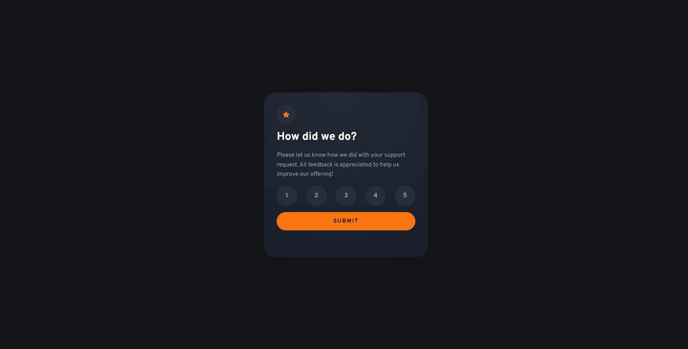
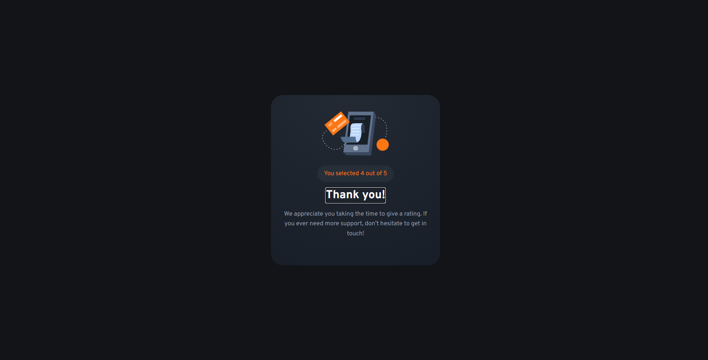
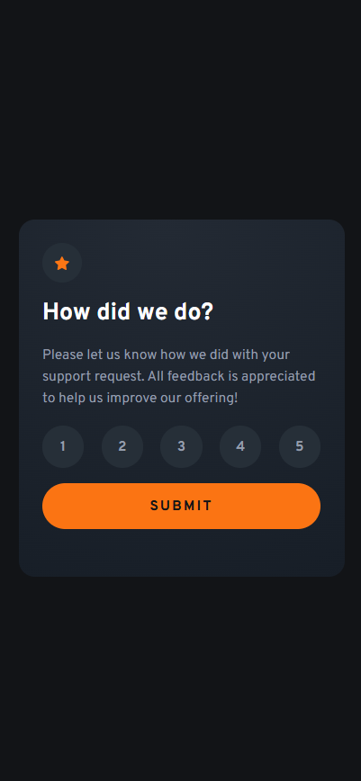
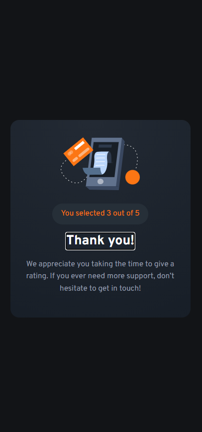

# Interactive Rating Component · Frontend Mentor

An interactive rating component built with HTML, CSS, and JavaScript for the [Frontend Mentor challenge](https://www.frontendmentor.io/challenges/interactive-rating-component-koxpeBUmI). The goal was to build a responsive interface while learning native forms, visual states, and DOM manipulation through incremental development.

[Versión en español](./README.md) · [Live site](https://jesusaid.github.io/Interactive-rating-component/) · [Repository](https://github.com/JesuSaid/Interactive-rating-component)

## Result

### Desktop · Rating



### Desktop · Thank you



### Mobile · Rating



### Mobile · Thank you



The heading outline in the thank-you screenshots shows the focus moved there after submission.

## Features

- Select one rating from 1 to 5 and change it before submitting.
- Require a selection through native form validation.
- Display the last selected rating in the thank-you view.
- Switch views without reloading the page.
- Distinguish default, hover, selected, and keyboard focus states.
- Navigate with Tab and Shift + Tab, change options with arrow keys, and submit using the keyboard.
- Move focus to the thank-you heading after submission.
- Adapt both views to mobile and desktop screens.

The result is displayed only on the page: it is not sent to a server or stored between visits.

## Technologies and structure

A static project with no frameworks, runtime dependencies, or build step.

| File or folder | Responsibility |
| --- | --- |
| `index.html` | Semantic structure, form, and both views |
| `fonts.css` | Local Overpass fonts at weights 400 and 700 |
| `styles.css` | Tokens, mobile-first layout, Flexbox, Grid, and states |
| `script.js` | Submission, rating retrieval, result updates, and focus |
| `assets/font-Overpass/` | Font files and license |
| `assets/images/` | Icons, illustration, and result screenshots |
| `style-guide.md` | The challenge palette and general specifications |

To run the project, download or clone the repository and open `index.html` in a modern browser with `:has()` support. A local static server is also suitable. No package installation is required. The script uses `defer` so it runs after the HTML has been parsed.

## Process and lessons learned

### Semantic HTML and native controls

The content uses one `main` with separate rating and thank-you containers. Each view has its own heading, and only one view is visible at a time. The document keeps `lang="en"` because the interface copy is in English.

The form contains a `fieldset`, a `legend`, and five radio inputs. I learned the different responsibilities of their attributes: `id` uniquely identifies a control, `for` connects its label, `name` groups the options, and `value` represents the rating. A shared class does not replace a shared group name.

Adding `required` to one radio requires a selection within the group; it does not require that particular rating. The button explicitly uses `type="submit"`. Decorative SVGs have empty alternative text.

### Mobile-first CSS, sizing, and typography

The mobile layout came first, followed by desktop adjustments using `min-width: 49rem`, equivalent to 784px with a 16px initial font size. The breakpoint changes the card, circles, images, and typography to suit the available space.

References came from `style-guide.md`, the challenge images, and Penpot. Paragraph sizes follow the specific references: 14px on mobile and 15px on desktop, written as `0.875rem` and `0.9375rem`. Headings grow from 24px to 28px.

I learned that `calc()`, `min()`, and `clamp()` solve specific sizing needs rather than being mandatory additions to every project. A direct `rem` value is appropriate when it expresses the design decision clearly.

Colors and the font family are centralized in `:root`. Global `box-sizing: border-box` simplifies sizing, while logical properties such as `padding-block`, `inline-size`, and `min-block-size` express layout decisions. A minimum card height provides a shared baseline while allowing content to grow; it does not guarantee identical heights if a view needs more room.

Local fonts use `@font-face`, explicit weights, `font-display: swap`, and a generic `sans-serif` fallback. The button inherits the font family rather than relying on browser defaults.

### Composition, gradient, and states

Flexbox centers the card, distributes rating options, and arranges the thank-you view. Grid is used within rating items. Classes follow BEM, with elements such as `rating__label` and `thank-you__result`.

Separating the star image from its circular container made their sizes independent: a 14px icon inside a 40px circle on mobile, and a 17px icon inside a 48px circle on desktop. The illustration also keeps its proportions through an automatic height.

The card uses a radial gradient approximating Penpot, with the lighter center near the top and colors `#232A34` and `#171E27`. A debugging lesson was that gradients belong in `background-image` or `background`: a gradient assigned to `background-color` is invalid and ignored.

Radio inputs are visually hidden without `display: none`, preserving keyboard access. CSS reads their state and styles the visible label:

```css
.rating__pick:has(.rating__input:checked) .rating__label {
    background-color: var(--color-title);
    color: var(--color-surface);
}

.rating__pick:has(.rating__input:focus-visible) .rating__label {
    outline: 2px solid var(--color-title);
    outline-offset: 0.2rem;
}
```

The selected state belongs to the input, not its label. A white background communicates selection, while a separate outline communicates focus; hover and focus do not need identical effects. The thank-you view uses `.thank-you:not([hidden])` so its Flexbox display does not override the hidden state.

### JavaScript, submission, and focus management

The script listens for `submit` on the form, preserving native validation before the handler runs. Listening for a button click and canceling it prevented that validation flow from working as intended.

Inside the handler, `preventDefault()` stops navigation. Calling `form.querySelector('.rating__input:checked')` at submission time retrieves the latest selection. Its `value` property returns text, which is assigned to the result `span` using `textContent`.

The rating view then receives `hidden`, and the thank-you view has that attribute removed. Finally, `focus()` moves focus to the new heading. Its `tabindex="-1"` allows programmatic focus without adding the heading to the regular Tab sequence. Setting that attribute alone does not move focus.

### Git and deployment

Commits followed milestones: semantic HTML, fonts and base styles, interaction states, mobile thank-you styling, desktop layout, and accessible submission. Commit titles were written in English, with checks using `git status` and `git diff --check`.

I also learned to distinguish a local commit, a push, and a GitHub Pages deployment. A cached CSS copy can explain differences between updated files and the displayed site; checking deployment and served resources helps before assuming the code is wrong.

## Checks performed

Manual reviews during development confirmed:

- Both mobile and desktop views, including 320, 375, 768, and 1440px widths.
- The breakpoint transition at 783, 784, and 785px, with an additional check at 874px.
- Content wrapping, no observed horizontal overflow, and zoom at 200% and 400%.
- Rating selection and changes before submission, with the result matching the last selected value.
- The native warning when submitting without a selection.
- Tab, Shift + Tab, and arrow-key navigation, keyboard submission, and focus on the thank-you heading.
- Hover, selected, and focus states.
- HTML and CSS validation, console checks, and font and asset loading.
- Whitespace checks with `git diff --check`.

These checks were performed manually and confirmed by the author during the challenge. They are not a comprehensive accessibility audit or an automated test suite.

## Continued development

- Testing with screen readers and different browsers.
- Automated tests for selection, validation, submission, and focus.
- Progressive enhancement: the thank-you transition requires JavaScript; without it, the form does not complete this interaction.
- Refining spacing and gradient extent through visual comparison.
- Fluid typography and spacing when they provide a concrete improvement.

## References and credits

- [Frontend Mentor](https://www.frontendmentor.io/) provided the challenge and starter assets.
- [Design and style guide in Penpot](https://design.penpot.app/?screen=workspace&team-id=2f1be954-9d1b-812a-8008-e7176a4d30b3&project-id=2f1be954-9d1b-812a-8008-e7176a4dacc4&file-id=3eb96054-c396-811e-8008-f621ecac236b&page-id=eff49dbe-3feb-80ce-8008-f6262ea55200).
- Overpass font; license included in `assets/font-Overpass/OFL.txt`.
- Developed by [JesuSaid](https://github.com/JesuSaid).

### AI collaboration

I used ChatGPT/Codex to plan milestones, understand concepts, review my changes, and debug specific issues. I wrote and adjusted the component incrementally and checked its behavior in the browser. AI also helped inspect the Penpot references and draft this documentation from the code and checks performed.
