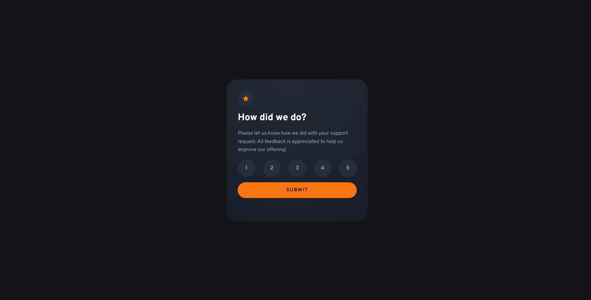
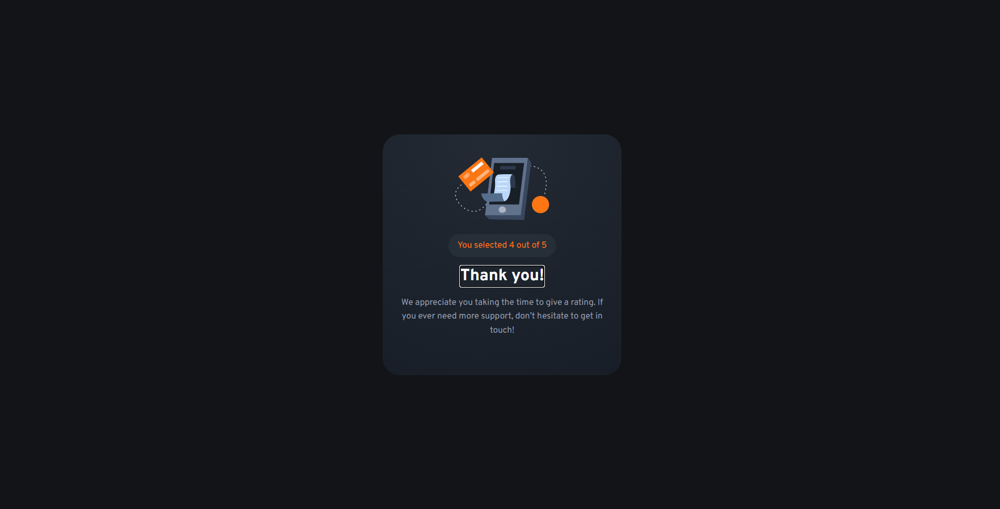
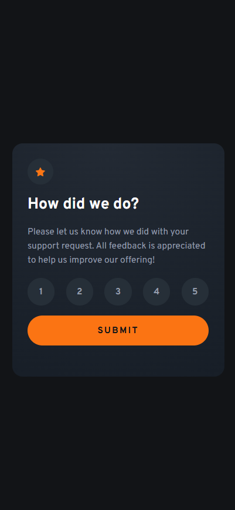
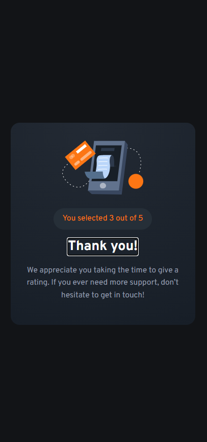

# Interactive Rating Component · Frontend Mentor

Componente de valoración interactiva desarrollado con HTML, CSS y JavaScript como solución al [reto de Frontend Mentor](https://www.frontendmentor.io/challenges/interactive-rating-component-koxpeBUmI). El objetivo fue construir una interfaz responsive y practicar formularios nativos, estados visuales y manipulación del DOM, entendiendo cada decisión paso a paso.

[English version](./README-en.md) · [Sitio publicado](https://jesusaid.github.io/Interactive-rating-component/) · [Repositorio](https://github.com/JesuSaid/Interactive-rating-component)

## Resultado

### Escritorio · Valoración



### Escritorio · Agradecimiento



### Móvil · Valoración



### Móvil · Agradecimiento



El contorno del título en las capturas de agradecimiento corresponde al foco que recibe después del envío.

## Funcionalidades

- Elegir una única puntuación del 1 al 5 y cambiarla antes de enviar.
- Exigir una selección mediante la validación nativa del formulario.
- Mostrar en el agradecimiento la última puntuación seleccionada.
- Cambiar de vista sin recargar la página.
- Distinguir reposo, hover, selección y foco de teclado.
- Navegar con Tab y Shift + Tab, cambiar de opción con las flechas y activar el envío con teclado.
- Trasladar el foco al título del agradecimiento después del envío.
- Adaptar ambas vistas a móvil y escritorio.

El resultado se muestra únicamente en la página: no se envía a un servidor ni se guarda entre visitas.

## Tecnologías y organización

Proyecto estático, sin frameworks, dependencias de ejecución ni proceso de compilación.

| Archivo o carpeta | Responsabilidad |
| --- | --- |
| `index.html` | Estructura semántica, formulario y ambas vistas |
| `fonts.css` | Fuentes locales Overpass en pesos 400 y 700 |
| `styles.css` | Tokens, diseño mobile-first, Flexbox, Grid y estados |
| `script.js` | Envío, lectura de la puntuación, actualización del resultado y foco |
| `assets/font-Overpass/` | Archivos de fuente y licencia |
| `assets/images/` | Iconos, ilustración y capturas del resultado |
| `style-guide.md` | Paleta y especificaciones generales del reto |

Para ejecutarlo, descarga o clona el repositorio y abre `index.html` en un navegador moderno con soporte de `:has()`. También puedes utilizar un servidor estático local. No hace falta instalar paquetes. El script se carga con `defer` para ejecutarse después de analizar el HTML.

## Proceso y aprendizajes

### HTML semántico y controles nativos

El contenido se organiza en un único `main`, con contenedores separados para valoración y agradecimiento. Cada vista tiene su título y solo una permanece visible. Se conserva `lang="en"` porque el texto de la interfaz está en inglés.

La puntuación utiliza un formulario con `fieldset`, `legend` y cinco radios. Aprendí a distinguir los atributos de cada control: `id` identifica un elemento único, `for` relaciona su etiqueta, `name` agrupa las opciones y `value` representa la puntuación. Compartir una clase no sustituye compartir el nombre del grupo.

El atributo `required` en uno de los radios exige una selección del grupo; no obliga a elegir esa puntuación concreta. El botón declara `type="submit"`. Los SVG decorativos usan `alt=""`.

### CSS mobile-first, medidas y tipografía

Primero se construyó la presentación móvil y después se añadieron ajustes con `min-width: 49rem`, equivalente a 784px con un tamaño inicial de fuente de 16px. El breakpoint ajusta la tarjeta, los círculos, las imágenes y la tipografía según el espacio disponible.

Las referencias se consultaron en `style-guide.md`, las imágenes del reto y Penpot. El párrafo utiliza 14px en la referencia móvil y 15px en escritorio, expresados como `0.875rem` y `0.9375rem`. El título pasa de 24px a 28px.

Aprendí que `calc()`, `min()` y `clamp()` son herramientas para necesidades concretas, no requisitos que deban aparecer en todos los proyectos. Cuando una medida directa en `rem` expresa claramente la decisión, no hace falta añadir una función.

Se centralizaron colores y familia tipográfica en `:root`, se aplicó `box-sizing: border-box` y se utilizaron propiedades lógicas como `padding-block`, `inline-size` y `min-block-size`. La altura mínima da una base común a ambas vistas y permite crecer con el contenido; no garantiza una altura idéntica si alguna vista necesita más espacio.

Las fuentes locales se declaran con `@font-face`, pesos explícitos, `font-display: swap` y respaldo `sans-serif`. El botón hereda la familia tipográfica para evitar depender de su apariencia predeterminada.

### Composición, degradado y estados

Flexbox centra la tarjeta, distribuye las puntuaciones y organiza el agradecimiento. Grid se utiliza en los elementos de opción. Las clases siguen BEM, con elementos como `rating__label` y `thank-you__result`.

Separar la estrella de su contenedor permitió controlar el icono y el fondo circular de forma independiente: 14px dentro de 40px en móvil y 17px dentro de 48px en escritorio. La ilustración también conserva su proporción mediante altura automática.

El fondo usa un degradado radial aproximado al de Penpot, con el centro claro cerca del borde superior y colores `#232A34` y `#171E27`. Un aprendizaje de depuración fue que los degradados se aplican con `background-image` o `background`: una declaración de degradado en `background-color` es inválida y el navegador la ignora.

Los radios se ocultan visualmente sin usar `display: none`, para conservar su acceso con teclado. CSS consulta su estado y cambia la etiqueta visible:

```css
.rating__pick:has(.rating__input:checked) .rating__label {
    background-color: var(--color-title);
    color: var(--color-surface);
}

.rating__pick:has(.rating__input:focus-visible) .rating__label {
    outline: 2px solid var(--color-title);
    outline-offset: 0.2rem;
}
```

La selección pertenece al input, no al label. El fondo blanco comunica selección y el contorno separado comunica foco; hover y foco no necesitan producir el mismo efecto. El agradecimiento usa `.thank-you:not([hidden])` para que Flexbox no anule su ocultación.

### JavaScript, envío y gestión del foco

El script escucha `submit` en el formulario. Esto conserva la validación nativa antes de ejecutar el manejador. Escuchar el clic del botón y cancelarlo impedía aprovechar correctamente ese flujo.

Dentro del evento, `preventDefault()` evita la navegación. La consulta `form.querySelector('.rating__input:checked')` obtiene la selección en el momento del envío, por lo que refleja el último cambio. Su propiedad `value` devuelve texto y se asigna al `span` con `textContent`.

Después se añade `hidden` a la valoración y se retira del agradecimiento. Finalmente, `focus()` lleva el foco al nuevo título. El atributo `tabindex="-1"` permite enfocar ese encabezado desde JavaScript sin añadirlo al recorrido normal de Tab. Darle ese atributo no mueve el foco por sí solo.

### Git y publicación

Los commits se organizaron en hitos: estructura HTML, fuentes y estilos base, estados de interacción, agradecimiento móvil, escritorio y envío accesible. Se utilizaron títulos en inglés y revisiones con `git status` y `git diff --check`.

También se aprendió a distinguir commit local, push y publicación en GitHub Pages. Una copia antigua del CSS en caché puede explicar diferencias entre el sitio y los archivos actualizados; conviene comprobar el despliegue y los recursos antes de atribuir el problema al código.

## Comprobaciones realizadas

Durante el desarrollo se realizaron revisiones manuales y se confirmó el funcionamiento de:

- Ambas vistas en móvil y escritorio, incluyendo 320, 375, 768 y 1440px.
- Transición alrededor del breakpoint: 783, 784 y 785px; también se revisó 874px.
- Ajuste del contenido, ausencia de desbordamientos observados y zoom al 200% y 400%.
- Selección y cambio de puntuación antes del envío; resultado correspondiente al último valor elegido.
- Advertencia nativa al intentar enviar sin selección.
- Navegación con Tab, Shift + Tab y flechas, envío con teclado y foco en el agradecimiento.
- Estados de hover, selección y foco.
- Validación de HTML y CSS, consola y carga de fuentes y recursos.
- Revisión de espacios con `git diff --check`.

Estas comprobaciones se realizaron manualmente y fueron confirmadas por el autor durante el reto. No constituyen una auditoría completa de accesibilidad ni una suite de pruebas automatizadas.

## Qué seguir practicando

- Pruebas con lectores de pantalla y distintos navegadores.
- Automatización de pruebas de selección, validación, envío y foco.
- Mejora progresiva: el cambio a agradecimiento requiere JavaScript; sin él, el formulario no completa esta interacción.
- Afinar espaciados y la extensión del degradado mediante comparación visual.
- Tipografía y espacios fluidos cuando aporten una mejora concreta.

## Referencias y créditos

- [Frontend Mentor](https://www.frontendmentor.io/) proporcionó el reto y los recursos iniciales.
- [Diseño y guía en Penpot](https://design.penpot.app/?screen=workspace&team-id=2f1be954-9d1b-812a-8008-e7176a4d30b3&project-id=2f1be954-9d1b-812a-8008-e7176a4dacc4&file-id=3eb96054-c396-811e-8008-f621ecac236b&page-id=eff49dbe-3feb-80ce-8008-f6262ea55200).
- Fuente Overpass; licencia incluida en `assets/font-Overpass/OFL.txt`.
- Desarrollo: [JesuSaid](https://github.com/JesuSaid).

### Acompañamiento con IA

Utilicé ChatGPT/Codex como apoyo para planificar etapas, entender conceptos, revisar mis cambios y depurar problemas concretos. Escribí y ajusté el componente de forma incremental y comprobé su funcionamiento en el navegador. La IA también ayudó a consultar las referencias de Penpot y a redactar esta documentación a partir del código y las pruebas realizadas.
